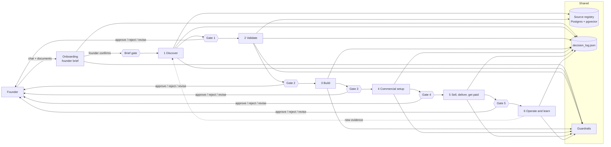
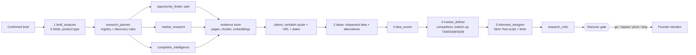
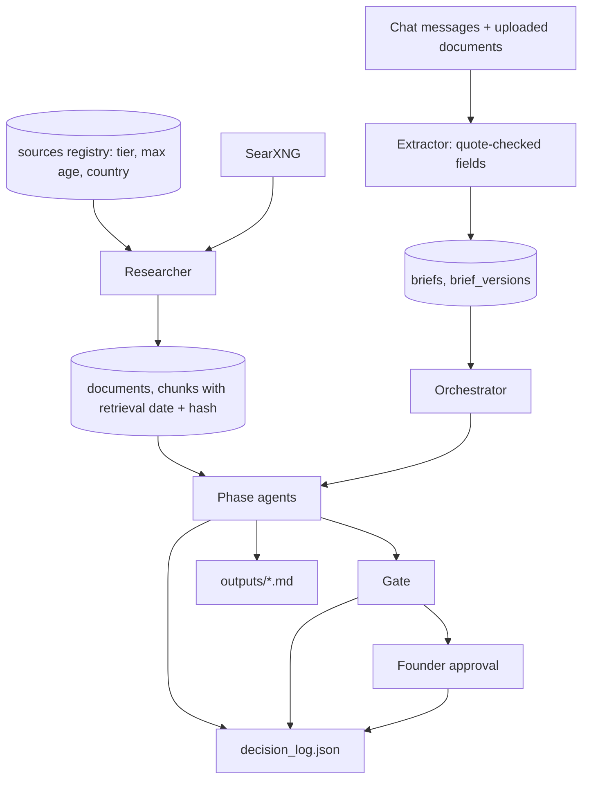

# Architecture

## Overview

Venture OS takes a founder's idea through six phases (Discover, Validate, Build, Commercial setup,
Sell/deliver/get paid, Operate and learn) toward a validated **digital** product. Agents do the work; plain code
controls the flow. Every phase ends at a **gate** that returns go / repeat / pivot / stop, and nothing moves on,
is published, sent or spent without the founder's explicit approval in the UI. Every claim cites a source URL or
is labelled `ASSUMPTION`, and every agent action is appended to `decision_log.json`.

Status today: all six phases run in the pipeline, each after the founder's go on the previous one. Posting,
payments, delivery and refunds are `MOCKED`; support and analytics are `STUBBED`; the Phase 5 store page and posts
are rule-based drafts (`STUBBED`). See [Built vs. stubbed](#built-vs-stubbed).

- Gate outcomes are go, repeat, pivot or stop; the gate recommends and the founder decides. See [Gates](#gates).
- STOP is recommended on weak evidence: excluded product, too few sourced claims, or a missed demand target. See [When the system recommends STOP](#gates).
- Sale to cash: founder-approved order -> mock payment -> delivery once -> refund revokes access -> reconciliation. See [Sale to cash](#sale-to-cash).

Inside a phase, each step is guarded by code checks: the interview script linter, score caps on unevidenced
criteria, the research critic, and the MVP QA checks.



## Phases

Phase 0 is onboarding: it produces the brief every phase reads. Outputs follow the naming
`outputs/phase<N>_step<M>_<name>.md` and `outputs/phase<N>_gate_decision.md`.

### Phase 0: Onboarding (founder brief) — Working

- **Agents:** brief extractor, brief tagger, follow-up writer (prompts in `prompts/brief_*.md`,
  `prompts/followup_questions.md`); code in `src/venture_os/onboarding/`.
- **Tools:** document reader (PDF, Word, text; text only, 10 MB limit), budget parser, product check,
  guardrails. Model: Fanar-C-2-27B (Arabic incl. Egyptian dialect, English) via a free API; with no model the
  chat still works rule by rule.
- **Method:** a chat asks for the 7 required fields (idea, problem, customer, country, budget, time, skills),
  offers 5 optional ones, then up to 3 follow-up questions only the founder can answer. Research questions are
  passed to Discover instead of being asked. A value from the model is kept only if its quote appears in the
  founder's text; "skip" stores *unknown*, never a guess. Document text is treated as untrusted data.
- **Output:** a versioned brief (`brief_versions` table), tags used to choose sources (country code,
  industries, customer type, revenue model), and `outputs/phase1_step0_founder_brief.md` on confirmation.

### Phase 1: Discover — Working (core step: find opportunities)

Starts when the founder confirms the brief (that confirmation is the approval to research); `orchestrator.py`
runs the steps below and ends at the founder's gate. Gate thresholds are read from `config/gates/discover.yaml`
and logged (`set_gate_thresholds`) **before** any research.



- **Agents (`agents/`):** `brief_analyzer`, `research_planner`, `market_research` and `competitor_intelligence`
  (tool-using `ResearchAgent`s), `opportunity_finder`, `idea_scorer`, `market_definer`, `interview_designer`,
  `research_critic`. Prompts: one file each in `prompts/`.
- **Tools:** SearXNG (spaced queries), page fetcher, free APIs with no key (HN Algolia, Stack Exchange, GitHub,
  iTunes Search and App Store reviews, WordPress plugins, npm, World Bank), the source registry filtered by
  `product_scope` (digital/any; goods-trade sources excluded), and hybrid search (keyword + `bge-m3` vectors) over
  the evidence store and the method corpus (team-written summaries with links, never book text).
- **Method:**
  1. Brief: the six required fields; unknown stays unknown. The product type is decided by rules and must be
     digital; excluded products are refused before any research.
  2. Opportunities: find people describing the pain. A claim is kept only with a verbatim quote found in the
     stored page, its URL and dates. Page text is data: instructions inside pages are ignored and logged. Then the
     founder's idea is sharpened and alternatives are proposed for the same pain.
  3. Scoring: 1–5 per criterion against the founder's skills, hours and budget. A score without evidence is
     capped at 3 and labelled `ASSUMPTION`, and totals are computed in code.
  4. Market: competitors and substitutes with sourced prices, and a bottom-up TAM/SAM/SOM where every input is
     either sourced or labelled `ASSUMPTION`.
  5. Interviews (The Mom Test):
     - a script linter rejects hypothetical, pitching and compliment-seeking questions (EN + AR) and rewrites
       them about past behaviour;
     - the founder's notes are tagged, and only past behaviour, current workarounds, money or time already spent
       and commitments count as evidence.
  6. Critic: rule checks, plus a second-opinion model of a **different family** when one is configured (otherwise the
     critic says the model review was skipped).
- **Output:** `phase1_step1_brief`, `phase1_step2_opportunities`, `phase1_step3_idea_scores`, `phase1_step4_market`,
  `phase1_step5_interview_plan` and `phase1_gate_decision` (`.md` + `.json` each).

### Phase 2: Validate (core step: Design the business) — Working

- **Agents:** `business_designer.py` (Lean Canvas), `landing_page.py` (draft page), `demand_test.py` (result +
  gate). **Tools:** confirmed brief, Phase 1 evidence items (`evidence.load`), `gates.plan_demand_test` /
  `demand_gate`, guardrails. Model optional (`prompts/business_designer.md`, `prompts/landing_page.md`).
- **Method:**
  1. *Lean Canvas:* 9 boxes; every entry is FOUNDER (quoted brief field), EVIDENCED (evidence id + URL + date),
     ASSUMPTION, or UNKNOWN (never filled in). A model-cited evidence id that does not exist becomes ASSUMPTION;
     income statements are dropped. Names the riskiest assumption.
  2. *Demand test declared first:* target 100 waitlist sign-ups in 14 days is fixed before the page exists.
  3. *Landing page:* one self-contained HTML file (no external URLs), email-only waitlist that sends nothing,
     banner "DRAFT — not published (MOCKED)"; copy is checked for testimonials, user counts, countdowns, scarcity
     and income claims. Publishing needs the founder's approval of the exact draft hash and is MOCKED.
  4. *Result:* the sign-up count is entered by the founder ("founder-reported, not verified"); never generated.
- **Output:** `phase2_step1_lean_canvas.md`, `phase2_step2_demand_test_plan.md`, `phase2_step2_landing_page.html`,
  `phase2_gate_demand.md`; evidence items for Phase 3 (riskiest assumption, demand result, gate outcome).

### Phase 3: Build — Working (core step: build the product)

One multi-agent stage, `build_stage.run_build_stage(brief)`, with **no founder approval inside it**: everything is
collected at the start and the founder approves once, at the build gate.

- **Agents:** `build_inputs` (entry check, code), `requirements_mapper`, `product_spec`, `mvp_planner`,
  `mvp_validator`, `mvp_builder`, `mvp_tester` (code + headless browser), `docs_writer` (code).
- **Method:** confirmed brief + the approved Discover findings + the approved Validate Lean Canvas (read from the
  database), each item labelled EVIDENCED / FOUNDER-STATED / INFERRED / ASSUMPTION -> requirements that cite their
  inputs -> a **product spec** written by the model from those facts: offer kind, offers (what is inside, for
  whom, price), the customer's first action, input fields, sample content, delivery, FAQ and block order. Code
  checks every value: one without a known source is labelled ASSUMPTION, must-never text is dropped, and a spec
  whose own names are not about this brief is rejected. -> a plan whose supporting screens follow the offer kind
  (no keyword matching) -> fixed-rule validation (up to 2 automatic re-plans) -> a single self-contained HTML MVP
  built from fixed, tested blocks (hero, try-it form with live preview, offers, buy and delivery MOCKED, waitlist
  MOCKED, FAQ); the model fills text only, shown as text; data stays on the device; Arabic right-to-left -> tests.
- **Tests:** 15 QA and safety checks plus checks computed from the brief at run time: key terms of this brief in
  the title, offers and core action; the core action is wired; every button has a handler; buy, delivery and
  waitlist labelled MOCKED; when a model is configured, the product was written by the model. On failure: one
  repair pass with the failures fed back, then rules only, then the failure goes to the gate (repeat).
- **Without a model** (replay, CI): no category is guessed; the page uses only the founder's own words.
- **Output:** `phase3_step1_build_inputs.md`, `phase3_step3_product_spec.md`, `phase3_step3_mvp_plan.md` …
  `phase3_step5_mvp.html` … `phase3_step8_evidence_summary.md`, `phase3_gate_build.md`.

### Phase 4: Commercial setup (core step: Set the price and policies) — Working

- **Entry point:** `commercial_stage.run_commercial_stage(brief_id, brief_version) -> CommercialResult` (gate
  decision, files, stubbed steps). No approval inside; the stage API starts it only after the founder's Go on Build
  for the same brief version, and the founder decides on its gate through `POST /stages/runs/{id}/decision`.
- **Agents (plain code, no model needed):** `agents/commercial_pricing.py` (pricing research, price setter),
  `agents/policy_drafter.py` (terms, privacy, refund), readiness checker. **Tools:** Phase 1-2 evidence items and
  the approved Discover run's claims; the source registry (official legal sources for the brief's country).
- **Method:** thresholds are logged before step 1. (1) Only prices from an EVIDENCED item with a source URL and a
  date are used; others are counted and left out. (2) Min / median / max in the main currency; proposed price =
  median; break-even = the founder's stated budget ÷ median price, as paying customer-months and per month over the
  founder's stated months; every figure labelled ESTIMATE, no income promised. (3-5) Each policy starts with
  "DRAFT — not legal advice"; country law only from official registry sources, otherwise "No verified official
  source found for <country>"; the refund policy says the founder approves each refund and an approved refund
  revokes access. (6) A readiness checklist. Findings are saved as Phase 4 evidence items for Phase 5.
  No payments of any kind.
- **Output:** `phase4_step1_pricing_research.md`, `phase4_step2_price.md`, `phase4_step3_terms.md`,
  `phase4_step4_privacy.md`, `phase4_step5_refund_policy.md`, `phase4_step6_readiness.md`,
  `phase4_gate_commercial.md`.

### Phase 5: Launch: sell, deliver, get paid (core steps: Open the store; deliver automatically) — runs in the pipeline; drafts STUBBED, posting and payments MOCKED

- **Store page contains:** the product, who it is for, the problem it addresses and the founder's stated price
  model, marked "DRAFT, not published (MOCKED)"; no urgency, reviews or user counts.
- **How a mock buyer receives it:** a founder-approved test order -> mock payment -> `delivery.deliver` grants
  access to the Phase 3 MVP once per order (an access code; a repeat event does not deliver twice) -> a refund
  calls `revoke`, after which `has_access` is false.
- **Entry point:** `launch_stage.run_launch_stage`, started after the founder's go on Commercial.
- **Agents:** `launch.py`; delivery is `delivery.py`. **Tools:** brief, the sale-to-cash mocks.
- **Method:** a store page draft and 3 launch post drafts with no urgency, reviews or user counts. Posting a draft
  needs the founder's approval of that exact text and is MOCKED. Delivery is automatic after a (mock) payment and
  happens once per order. The stage then runs the MOCKED sale-to-cash test (order, payment, delivery, refund,
  reconciliation); each test order and refund runs only if the founder already approved that exact payload.
- **Gate:** go if delivery happened once, the refund revoked access and reconciliation flagged the missing
  payment; otherwise repeat. The founder decides.
- **Output:** `phase5_step1_store_page.md`, `phase5_step2_launch_posts.md`, `phase5_gate_launch.md`,
  `payment_test_log.md` (from `scripts/payment_test.py`).

### Phase 6: Operate and learn — runs in the pipeline; support and analytics STUBBED

- **Entry point:** `operate_stage.run_operate_stage`, started after the founder's go on Launch.
- **Agent:** `operator.py`. **Tools:** `decision_log.json` and `outputs/` only.
- **Method:** a persevere-or-pivot memo built only from logged results (gate outcomes, the founder's sign-up count,
  the payment test); a metric without data says "no data yet"; support and analytics are STUBBED.
- **Output:** `phase6_step1_pivot_memo.md`, `phase6_gate_operate.md`.

## Gates

Gates are plain code (`gates.py`, `approval.py`), not prompts, so no agent can talk its way past one. A phase
starts only if the previous gate passed **for the same brief version**; editing the brief makes later gates stale.

| Gate | Checks | Outcomes |
|---|---|---|
| Brief (built) | All required fields answered or explicitly unknown; product is digital and allowed; founder typed "yes" | confirm, or keep editing |
| 1 Product (built) | The confirmed brief's product check: excluded product (physical goods, financial/crypto, health or legal advice) | excluded -> stop; otherwise go |
| 1 Evidence (built) | Claims with a real source URL after research | 0 sourced -> stop; fewer than 5 -> repeat; otherwise go |
| 1 Discover (built) | Thresholds from `config/gates/discover.yaml`, logged before research: ≥ 5 pain claims with quotes from ≥ 3 domains, ≥ 2 competitors with sourced prices, a top idea scoring ≥ 3.0 with every fit criterion ≥ 2, ≥ 5 founder interviews with ≥ 3 showing past behaviour | stop if: excluded product, zero sourced pain, no idea fits the founder's budget and time, or ≥ 8 free alternatives with nothing that differentiates. Pivot if the starting idea fails but an alternative passes. Go if every check passes; otherwise repeat, listing what to collect. The founder may waive only the interview checks, with a written reason |
| 2 Demand (built) | Waitlist sign-ups against a target **declared before the test** (e.g. 100 in 14 days); count entered by the founder or labelled MOCKED, never generated | target reached -> go; >= 50% -> repeat; >= 25% -> pivot; below 25% -> stop |
| 3 Build (built) | Build inputs (stop if Phase 2 said stop), plan validation, MVP QA checks | go / repeat / stop; the founder approves once |
| 4 Commercial (built) | Sourced prices (URL + date), break-even vs the founder's budget and months, readiness checklist | go: ready; repeat: fewer than 3 sourced prices or a missing section; pivot: break-even needs more than 100 paying customers a month within the founder's months; stop: excluded product or every sourced price free |
| 5 Launch (built; drafts STUBBED, posting and payments MOCKED) | Drafts pass the guardrails; the MOCKED sale-to-cash test delivers once, revokes access on refund and reconciliation flags the missing payment; every external action needs its own founder approval | go: the test completed; repeat: it could not run (no founder approval of the test order and refund); pivot / stop: not recommended by this gate's code, available as the founder's decision |
| 6 Operate (built; support and analytics STUBBED) | Logged gate outcomes, the founder's demand result and the payment test, from `decision_log.json` and `outputs/` only | stop: any logged stop; pivot: any logged pivot; repeat: no sign-up count or no logged gate, or any logged repeat; go: every logged gate go |

Every gate decision is written to `outputs/phase<N>_gate_<name>.md` (`phase1_gate_product.md`,
`phase1_gate_evidence.md`, `phase2_gate_demand.md`, `phase4_gate_commercial.md`, ...) and logged with its `outcome`, the target and the actual value.
Thresholds are fixed in code; a demand target is frozen when the test is declared, so it cannot be lowered after a
weak result (example: 12 of 100 sign-ups in 14 days -> **stop**). A gate only recommends: the founder approves,
rejects or asks for a revision, and only approval moves on.

**When the system recommends STOP:** the product is excluded (physical goods; financial, investment or crypto;
health or legal advice); too few sourced claims support the problem; most key claims are stale or only
`ASSUMPTION`; or a demand test misses its pre-set target. STOP is a recommendation the founder sees with the
reasons; the founder can pivot (edit the brief) or stop.

## Sale to cash

All of it is **MOCKED**: no payment provider, no sandbox, no network, no money. State is a local JSON file.

```mermaid
sequenceDiagram
  participant F as Founder (approval.py)
  participant P as payments.py
  participant D as delivery.py
  participant R as refunds.py
  participant C as reconcile.py
  F->>P: approve exact order (product, price, currency)
  P->>P: create_order (refused without approval)
  Note over P: mock event "succeeded" (event id)
  P->>D: payment triggers delivery
  D->>D: idempotency key = order id: grant access to phase3_step5_mvp.html once
  Note over P,D: same event again -> no-op; deliver again -> no-op
  F->>R: approve exact refund (order, amount)
  R->>D: refund revokes access
  C->>C: match orders, payments, fees (0), payouts (0); report each mismatch
```

- **Payment triggers delivery:** only a confirmed payment event grants access.
- **Refund revokes access:** a refund event removes it.
- **Idempotency:** each event id is processed once, so a repeated webhook never delivers twice.
- **Reconciliation:** orders, payments, fees and payouts are matched; mismatches are listed in
  `outputs/payment_test_log.md`.
- The founder approves the price and turning on checkout; going live is outside the hackathon scope.
- **Approval of the exact content (`approval.py`):**
  - Publishing the landing page, creating an order and refunding an order each check
    `has_founder_approval(brief_id, action, sha256)` first.
  - The approval covers that exact draft or payload: changing one character needs a new approval.
  - Only the founder records an approval: in the UI (founder session) or in the CLI by typing `approve`
    (`python -m venture_os.approval`).
  - The `founder_approvals` table refuses any other actor, channel or session, and agents can only read it.

## Data flow



- Postgres holds the registry (admin-only writes, every change logged), the evidence store (pgvector,
  1024-dimension BGE-M3 embeddings), briefs and onboarding sessions.
- Keys live only in `.env`; the database stores environment-variable names, never secret values.
- Uploaded files are reduced to text; the original file is not kept.

## Built vs. stubbed

| Part | Status |
|---|---|
| Onboarding (brief, tags, follow-ups, versions, product check, guardrails) | Working |
| Gates: product, evidence, demand | Working |
| Decision log, outputs, prompts, token metering, cost report | Working |
| Phase 1 Discover agents and gate | Working |
| Phase 2 Validate: Lean Canvas, demand test plan | Working |
| Phase 2 sign-up count + demand gate (`POST /stages/runs/{id}/signups`) | Working |
| Phase 2 landing page | Working; publishing MOCKED |
| Phase 3 Build stage (8 agents incl. the product spec, build gate, single-file HTML MVP) | Working; buy, delivery and waitlist in the MVP MOCKED |
| Phase 4 Commercial (pricing research, price, policies, readiness, gate) | Working |
| Phase 5 Launch stage and gate (runs in the pipeline) | Working |
| Phase 5 store page and launch posts | STUBBED (rule-based drafts); posting MOCKED |
| Phase 6 persevere-or-pivot memo and gate (runs in the pipeline) | Working |
| Phase 6 support and analytics | STUBBED (no integrations; the memo says "no data yet") |
| Payments, delivery, refunds, reconciliation (run inside Phase 5) | MOCKED |
| `approval.py`: founder decisions at stage gates | Working |
| Founder approval of exact content: landing page, launch posts, order, refund (`POST /stages/approvals`, CLI) | Working |
| Founder decision to pass a phase gate (go / repeat / pivot / stop; only "go" passes) | Working |

The README table is the per-step status.

## Roadmap

1. Real waitlist traffic: publish the approved landing page for real (today publishing is MOCKED) so the demand test measures actual sign-ups.
2. Discover search for niche topics: on the CV/Notion template brief the search returned pages about outsourcing
   and web-design agencies, with 0 problem quotes and 0 priced competitors.
3. Pass today's date to the critic model: in the same run it misread a 2024 source date as "in the future".
4. MVP quality on live models: the CV/Notion brief once produced a generic library app that passed all 15 checks.
   The product-spec builder and relevance checks now catch that; next is a browser test of the core action on
   every live run and more block types (quiz, checklist, provider list).
5. Phases 4-6 beyond stubs: sourced pricing per market, legal sources per country, metrics from the MVP's own events.
6. Recorded model responses in CI for deterministic end-to-end runs; grounding and safety scores per commit.
7. More country source packs as reviewed YAML (`config/sources/`).
