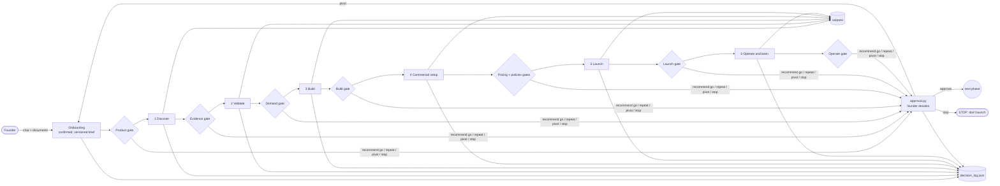
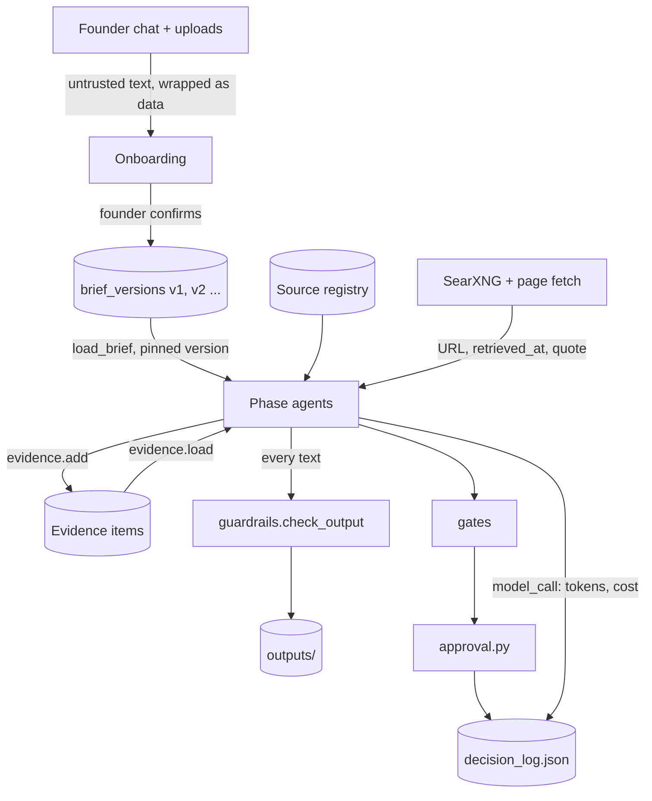

# Architecture

## Overview

Venture OS takes a founder's confirmed brief through six phases (Discover, Validate, Build, Commercial setup,
Launch, Operate and learn) toward a validated **digital** product. Agents do the work; plain code controls the flow.
Every phase ends at a **gate**: code that compares results with a rule fixed before the result was known and
recommends go / repeat / pivot / stop. A gate only recommends; the founder decides through `approval.py`, and nothing
is published, sent, spent or signed without that approval (all such actions are MOCKED). Every market claim cites a
source URL and date or is labelled `ASSUMPTION`, every agent action and model call is appended to
`decision_log.json`, and every result is written to `outputs/phase<N>_step<M>_<name>`. Everything runs on a local
open-weight model (`qwen3:4b-instruct` in Ollama) for $0, and every agent has a rule-based fallback when no model
is available.



| Layer | Component | Code |
|---|---|---|
| Interface | Streamlit app: onboarding chat, pipeline, decision log, sources | `ui/app.py`, `ui/pages/` |
| API | FastAPI (onboarding, registry) | `src/venture_os/api/` |
| Control (plain code) | Gates, guardrails, decision log, outputs, prompt loader | `gates.py`, `guardrails.py`, `decision_log.py`, `outputs.py`, `prompts.py` |
| Agents | One module per role, one prompt file per model-using agent | `src/venture_os/agents/<role>.py`, `prompts/<role>.md` |
| Sale to cash (MOCKED) | Payments, delivery, refunds, reconciliation | `payments.py`, `delivery.py`, `refunds.py`, `reconcile.py` |
| Models | One OpenAI-compatible client, profiles, token metering per call | `src/venture_os/llm/client.py` |
| Data | Postgres 16 + pgvector (source registry, briefs, sessions); JSON state for mocks | `db/schema.sql`, `config/sources/` |

## Phases

### Phase 0: Onboarding (before Discover) — Working

- **Agent:** Brief Analyzer (`src/venture_os/onboarding/`): Arabic (incl. Egyptian and Gulf dialect) and English
  chat with PDF/Word/text uploads. **Tools:** field extractor (model; a value is kept only if an exact quote
  supports it), tagger (fixed vocabulary), budget parser, `guardrails.check_product` / `check_request` / `redact`.
- **Method:** asks 7 required + 5 optional fields; "skip" stays unknown; inferred values are asked back; up to 3
  follow-up questions; research questions go to `open_questions` for Discover; excluded products cannot be confirmed.
- **Output:** a numbered brief version saved only on the founder's "yes" (logged `approved_by: "founder"`) ->
  `phase1_step0_founder_brief.md`. Pipeline entry: `onboarding.briefs.load_brief`, `is_stale`.

### Phase 1: Discover (core step: Find opportunities) — in progress, not on `main`

- **Agents:** research planner, market and competitor research, opportunity finder, idea scorer, market definer,
  Mom Test interview designer, research critic (Roufayda's branch). **Tools:** SearXNG search (Arabic + English),
  page fetch + extraction, the source registry (credibility tier, max age per source), Postgres evidence store.
- **Method:** plan queries from the brief tags and `open_questions`; keep each finding as a claim with URL,
  retrieval date and verbatim quote, or label it `ASSUMPTION`; score the starting idea against alternatives with
  totals computed in code; define the market; write a Mom Test interview script (past behaviour, no pitching).
- **Output:** `phase1_step<M>_*.md`, then the evidence gate (`gates.evidence_gate`) -> `phase1_gate_evidence.md`.

### Phase 2: Validate (core step: Design the business) — Working

- **Agents:** `business_designer.py` (Lean Canvas), `landing_page.py` (draft page), `demand_test.py` (result +
  gate). **Tools:** confirmed brief, Phase 1 evidence items (`evidence.load`), `gates.plan_demand_test` /
  `demand_gate`, guardrails. Model optional (`prompts/business_designer.md`, `prompts/landing_page.md`).
- **Method:**
  1. *Lean Canvas:* 9 boxes; every entry is FOUNDER (quoted brief field), EVIDENCED (evidence id + URL + date),
     ASSUMPTION, or UNKNOWN (never filled in). A model-cited evidence id that does not exist becomes ASSUMPTION;
     income statements are dropped. Names the riskiest assumption.
  2. *Demand test declared first:* target 100 waitlist sign-ups in 14 days is fixed before the page exists.
  3. *Landing page:* one self-contained HTML file (no external URLs), email-only waitlist that sends nothing,
     banner "DRAFT — not published (MOCKED)"; copy is checked for testimonials, user counts, countdowns, scarcity
     and income claims. Publishing needs the founder's approval of the exact draft hash and is MOCKED.
  4. *Result:* the sign-up count is entered by the founder ("founder-reported, not verified"); never generated.
- **Output:** `phase2_step1_lean_canvas.md`, `phase2_step2_demand_test_plan.md`, `phase2_step2_landing_page.html`,
  `phase2_gate_demand.md`; evidence items for Phase 3 (riskiest assumption, demand result, gate outcome).

### Phase 3: Build (core step: Build the product) — in progress, not on `main`

- **Agents (Menna's branch):** build inputs (entry check), requirements mapper, MVP planner, MVP validator, MVP
  builder, MVP tester, docs writer. **Tools:** evidence items from Phases 1-2, 5 fixed MVP templates, test runner.
- **Method:** stop if Phase 2 said stop; every requirement cites evidence or is labelled; the smallest scope that
  fits budget, time and skills; the model writes copy only, never code; tests check no outside calls, no
  password/card fields, payments MOCKED; one founder approval at the end.
- **Output:** `phase3_step1..7_*.md`, `phase3_step5_mvp.html` (the product `delivery.py` grants access to),
  `phase3_gate_build.md`.

### Phase 4: Commercial setup (core step: Set the price and policies) — STUBBED

- **Agents:** `pricing.py`, `policies.py`. **Tools:** brief, evidence items with competitor prices.
- **Method:** price hypotheses where each price is the founder's stated model, a sourced competitor price, or
  ASSUMPTION; no income or sales forecast. Draft terms, privacy and refund policy headed "DRAFT, not legal advice;
  have it reviewed"; the refund policy describes what `refunds.py` does (founder approves, access revoked).
  No payments of any kind.
- **Output:** `phase4_step1_pricing.md`, `phase4_step2_policies.md`, `phase4_gate_pricing.md`,
  `phase4_gate_policies.md`.

### Phase 5: Launch (core steps: Open the store; deliver automatically) — STUBBED / MOCKED

- **Agents:** `launch.py`; delivery is `delivery.py`. **Tools:** brief, the sale-to-cash mocks.
- **Method:** a store page draft and 3 launch post drafts with no urgency, reviews or user counts. Posting a draft
  needs the founder's approval of that exact text and is MOCKED. Delivery is automatic after a (mock) payment and
  happens once per order.
- **Output:** `phase5_step1_store_page.md`, `phase5_step2_launch_posts.md`, `phase5_gate_launch.md`,
  `payment_test_log.md` (from `scripts/payment_test.py`).

### Phase 6: Operate and learn — STUBBED

- **Agent:** `operator.py`. **Tools:** `decision_log.json` and `outputs/` only.
- **Method:** a persevere-or-pivot memo built only from logged results (gate outcomes, the founder's sign-up count,
  the payment test); a metric without data says "no data yet"; support and analytics are STUBBED.
- **Output:** `phase6_step1_pivot_memo.md`, `phase6_gate_operate.md`.

## Gates

A gate is plain code. It writes `outputs/phase<N>_gate_<name>.md` and a log entry with `outcome`, and only
**recommends**: moving past it needs the founder's approval through `approval.py` (`agents/stubbed.pass_gate`
refuses without it and fails closed while `approval.py` is not available).

| Gate | Checks (rule fixed before the result) | go | repeat | pivot | stop |
|---|---|---|---|---|---|
| Product (`gates.product_gate`) | excluded category (physical goods, financial/crypto, health or legal advice) | allowed or borderline | | | excluded product |
| Evidence, Phase 1 (`gates.evidence_gate`) | number of claims with a real source URL | ≥ 5 sourced claims | 1-4 | | 0 sourced claims |
| Demand, Phase 2 (`gates.demand_gate`) | founder-entered sign-ups vs the target declared beforehand | target reached | ≥ 50%, test still running, or no count entered | ≥ 25% | below 25% |
| Pricing, Phase 4 | a founder or sourced price exists | yes | none | | excluded product |
| Policies, Phase 4 | terms, privacy, refund drafts present and labelled DRAFT | yes | missing | | |
| Launch, Phase 5 | drafts pass the guardrails; every external action needs approval | yes | | | |
| Operate, Phase 6 | logged gate outcomes and demand result | all go | results missing | any pivot | any stop |

**When the system recommends STOP on weak evidence:** no sourced claim at all, an excluded product, or a measured
result far below the target fixed in advance. Example: 12 of 100 sign-ups in 14 days -> 12% -> **stop**, with the
reason in plain words ("the evidence does not support launching this idea") and the count labelled
founder-reported. The system never reframes a missed target; the founder makes the final call and that decision is
logged separately.

## Sale to cash

All of it is **MOCKED**: no payment provider, no sandbox, no network, no money. State is a local JSON file.

```mermaid
sequenceDiagram
  participant F as Founder (approval.py)
  participant P as payments.py
  participant D as delivery.py
  participant R as refunds.py
  participant C as reconcile.py
  F->>P: approve exact order (product, price, currency)
  P->>P: create_order (refused without approval)
  Note over P: mock event "succeeded" (event id)
  P->>D: payment triggers delivery
  D->>D: idempotency key = order id: grant access to phase3_step5_mvp.html once
  Note over P,D: same event again -> no-op; deliver again -> no-op
  F->>R: approve exact refund (order, amount)
  R->>D: refund revokes access
  C->>C: match orders, payments, fees (0), payouts (0); report each mismatch
```

- **Payment triggers delivery:** delivery requires a succeeded payment for that order.
- **A refund revokes access:** `has_access()` is false afterwards. Refunds are never automatic.
- **Idempotency:** a repeated payment event id and a repeated delivery are logged no-ops.
- **Reconciliation:** flags orders without a payment, payments without an order, delivery without payment, access
  still active after a refund, amount mismatches and any non-zero fee or payout.
- `scripts/payment_test.py` runs the scenario (incl. one missing payment) and writes `outputs/payment_test_log.md`.

## Data flow



- Uploaded documents and fetched pages are data, never instructions; agents have no tool that publishes, sends or
  spends; those actions exist only behind a founder approval and are MOCKED.
- Secrets live only in `.env`; the database stores env var names, never values.
- Cost per run: `llm/client.py` logs prompt and completion tokens for every model call; `scripts/cost_report.py`
  sums them.

## Built vs. stubbed

| Part | Status |
|---|---|
| Onboarding (brief, tags, follow-ups, versions, product check, guardrails) | Working |
| Gates: product, evidence, demand | Working |
| Decision log, outputs, prompts, token metering, cost report | Working |
| Phase 1 Discover | In progress (not on `main`) |
| Phase 2 Validate: Lean Canvas, demand test, demand gate | Working |
| Phase 2 landing page | Working draft; publishing MOCKED |
| Phase 3 Build | In progress (not on `main`) |
| Phase 4 pricing and policies | STUBBED |
| Phase 5 store page and launch posts | STUBBED; posting MOCKED |
| Phase 6 persevere-or-pivot memo | STUBBED (support, analytics: no data yet) |
| Payments, delivery, refunds, reconciliation | MOCKED |
| `approval.py` founder approvals | In progress (not on `main`); every approval check fails closed until it lands |

The README table is the per-step status.

## Roadmap

1. Land the orchestrator and `approval.py` so the founder can pass each gate in the UI.
2. Phases 1 and 3 on `main`; Phase 2 reads Phase 1 evidence items end to end.
3. Phases 4-6 beyond stubs: sourced pricing per market, legal sources per country, metrics from the MVP's own events.
4. Recorded model responses in CI for deterministic end-to-end runs; grounding and safety scores per commit.
5. More country source packs as reviewed YAML (`config/sources/`).
