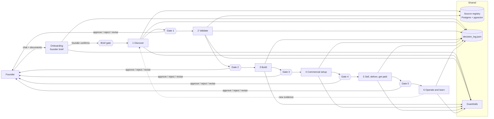
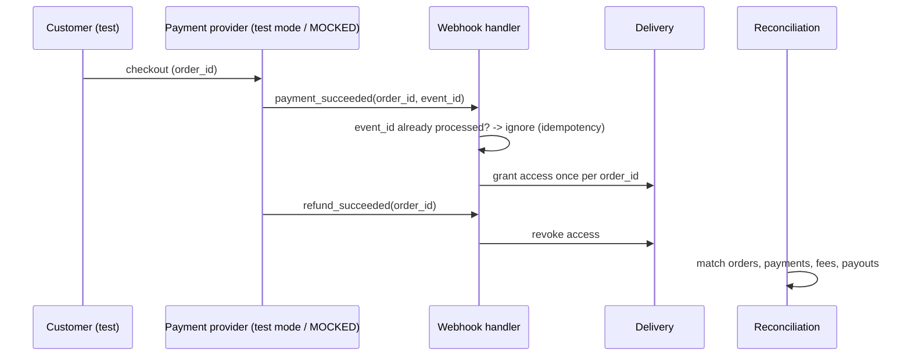
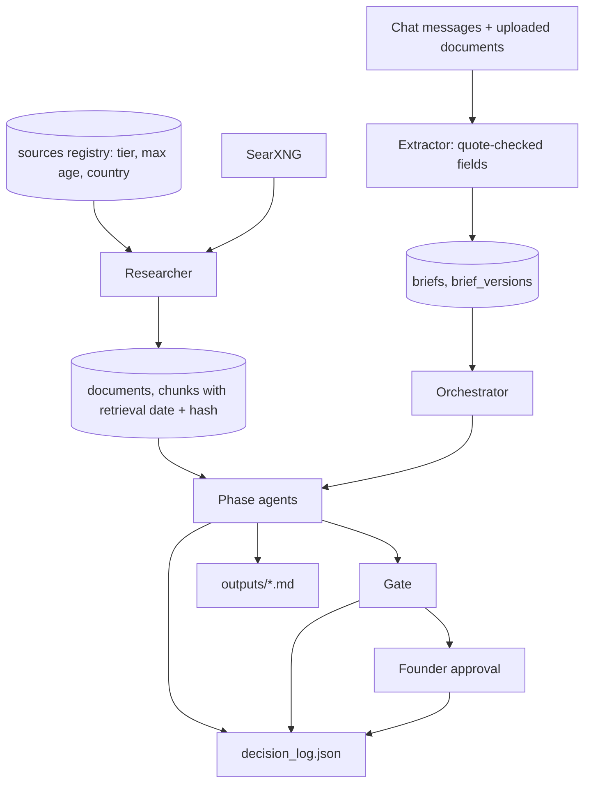

# Architecture

## Overview

Venture OS takes a founder's idea through six phases (Discover, Validate, Build, Commercial setup,
Sell/deliver/get paid, Operate and learn) toward a validated **digital** product. Agents do the work; plain code
controls the flow. Every phase ends at a **gate** that returns go / repeat / pivot / stop, and nothing moves on,
is published, sent or spent without the founder's explicit approval in the UI. Every claim cites a source URL or
is labelled `ASSUMPTION`, and every agent action is appended to `decision_log.json`.

Status today: onboarding (the founder brief), guardrails, the source registry, the decision log and the outputs
writer are **built and tested**. Phases 1-2 and the gates are being built; phases 3-6 will ship as labelled
`STUBBED` agents; all payments and delivery are `MOCKED`. See [Built vs. stubbed](#built-vs-stubbed).

## Phases

Phase 0 is onboarding: it produces the brief every phase reads. Outputs follow the naming
`outputs/phase<N>_step<M>_<name>.md` and `outputs/phase<N>_gate_decision.md`.

### Phase 0: Onboarding (founder brief) — Working

- **Agents:** brief extractor, brief tagger, follow-up writer (prompts in `prompts/brief_*.md`,
  `prompts/followup_questions.md`); code in `src/venture_os/onboarding/`.
- **Tools:** document reader (PDF, Word, text; text only, 10 MB limit), budget parser, product check,
  guardrails. Model: Fanar-C-2-27B (Arabic incl. Egyptian dialect, English) via a free API; with no model the
  chat still works rule by rule.
- **Method:** a chat asks for the 7 required fields (idea, problem, customer, country, budget, time, skills),
  offers 5 optional ones, then up to 3 follow-up questions only the founder can answer. Research questions are
  passed to Discover instead of being asked. A value from the model is kept only if its quote appears in the
  founder's text; "skip" stores *unknown*, never a guess. Document text is treated as untrusted data.
- **Output:** a versioned brief (`brief_versions` table), tags used to choose sources (country code,
  industries, customer type, revenue model), and `outputs/phase1_step0_founder_brief.md` on confirmation.

### Phase 1: Discover — in progress (core step: find opportunities)

- **Agents:** researcher (`agents/researcher.py`), interviewer (`agents/interviewer.py`).
- **Tools:** SearXNG search, page fetcher and text extraction, the source registry (121 sources tiered A/B/C with
  a maximum age; country packs such as Egypt), the source validator for newly found official sites.
- **Method:** search only allowlisted domains for market size, trends, competitors and pain points; store each
  claim with its source URL, retrieval date and exact quote; anything unsourced is labelled `ASSUMPTION`; stale
  figures are flagged. Draft a Mom-Test interview script.
- **Output:** `phase1_step1_opportunities.md`, `phase1_step2_interview_script.md`, `phase1_gate_decision.md`.

### Phase 2: Validate — in progress (core step: design the business)

- **Agents:** business designer (`agents/business_designer.py`).
- **Tools:** the phase-1 evidence store, guardrails on every generated text.
- **Method:** a Lean Canvas built only from evidenced pains; a landing-page draft with a pre-set waitlist target
  (e.g. 100 sign-ups in 14 days). Sign-up counts are entered by the founder or `MOCKED`, never invented.
- **Output:** `phase2_step1_lean_canvas.md`, `phase2_step2_landing_page.html`, `phase2_gate_decision.md`.

### Phase 3: Build — STUBBED

- **Agents:** product requirements, MVP builder (`agents/` for phases 3-6).
- **Method:** PRD and user stories tied to validated pains; the MVP builder fills a fixed landing-page and core-flow
  template instead of writing free-form code.
- **Output:** `phase3_step1_prd.md`, `phase3_step2_mvp_template.md` (labelled `STUBBED`).

### Phase 4: Commercial setup — STUBBED

- **Agents:** pricing, policies.
- **Method:** price hypotheses from sourced competitor prices; draft terms, privacy and refund policies labelled
  as drafts that need local professional review. Country rules come only from official sources, or the output
  says no verified source exists.
- **Output:** `phase4_step1_pricing.md`, `phase4_step2_policies.md` (labelled `STUBBED`).

### Phase 5: Sell, deliver, get paid — MOCKED

- **Agents:** launch planner, delivery (`delivery.py`).
- **Method:** a store page draft and launch posts as drafts only; checkout runs in test mode or is mocked; see
  [Sale to cash](#sale-to-cash).
- **Output:** `phase5_step1_store_page.md`, `outputs/payment_test_log.md` (labelled `MOCKED`).

### Phase 6: Operate and learn — STUBBED

- **Agents:** learning reporter.
- **Method:** compare real metrics with the targets set at the gates; recommend persevere or pivot; send new
  evidence back to Discover and mark earlier gate decisions as stale when they no longer hold.
- **Output:** `phase6_step1_persevere_or_pivot.md` (labelled `STUBBED`).

## Gates

Gates are plain code (`gates.py`, `approval.py`), not prompts, so no agent can talk its way past one. A phase
starts only if the previous gate passed **for the same brief version**; editing the brief makes later gates stale.

| Gate | Checks | Outcomes |
|---|---|---|
| Brief (built) | All required fields answered or explicitly unknown; product is digital and allowed; founder typed "yes" | confirm, or keep editing |
| 1 Discover | Enough sourced, in-date claims per question; competitors found; no excluded product | go / repeat / pivot / stop |
| 2 Validate | Pains backed by evidence; waitlist result against its pre-set target | go / repeat / pivot / stop |
| 3 Build | Core flow works; tests pass | go / repeat / stop |
| 4 Commercial | Price and policies drafted; legal items sourced or marked "no verified source" | go / repeat |
| 5 Sell | Test payment, delivery and refund all pass | go / repeat |

Every gate decision is written to `outputs/phase<N>_gate_decision.md` and logged with its `outcome` and the
threshold used. The founder approves, rejects or asks for a revision; only approval moves on.

**When the system recommends STOP:** the product is excluded (physical goods; financial, investment or crypto;
health or legal advice); too few sourced claims support the problem; most key claims are stale or only
`ASSUMPTION`; or a demand test misses its pre-set target. STOP is a recommendation the founder sees with the
reasons; the founder can pivot (edit the brief) or stop.

## Sale to cash

All of this runs in test mode or is `MOCKED`; the system never holds, moves or refunds money by itself.

- **Payment triggers delivery:** only a confirmed payment event grants access.
- **Refund revokes access:** a refund event removes it.
- **Idempotency:** each event id is processed once, so a repeated webhook never delivers twice.
- **Reconciliation:** orders, payments, fees and payouts are matched; mismatches are listed in
  `outputs/payment_test_log.md`.
- The founder approves the price and turning on checkout; going live is outside the hackathon scope.

## Data flow

- Postgres holds the registry (admin-only writes, every change logged), the evidence store (pgvector,
  1024-dimension BGE-M3 embeddings), briefs and onboarding sessions.
- Keys live only in `.env`; the database stores environment-variable names, never secret values.
- Uploaded files are reduced to text; the original file is not kept.

## Built vs. stubbed

| Part | Status |
|---|---|
| Onboarding chat, document reading, versioned brief | Working |
| Guardrails (excluded products, refusals, output checks, redaction) | Working |
| Source registry, catalog, source validator, registry API | Working |
| Decision log and outputs writer | Working |
| Orchestrator, gates, founder approval | In progress |
| Phase 1 Discover, phase 2 Validate agents | In progress |
| Phases 3, 4, 6 agents | STUBBED (planned) |
| Phase 5 payments, delivery, refunds, reconciliation | MOCKED (planned) |
| One-command setup with a local open-weight model (Ollama) | In progress |

This table is updated as parts land on `main`; the README's "What works and what is mocked" table is the short
version.

## Roadmap

1. Phases 1-2 with gates, including a run that ends in STOP.
2. `docker compose up` with a local open-weight model, so no key is needed.
3. Phases 3-6 as labelled stubs, then real agents one phase at a time.
4. Test-mode payments with idempotent delivery and reconciliation.
5. More country packs for the registry and verified licences for every source.
