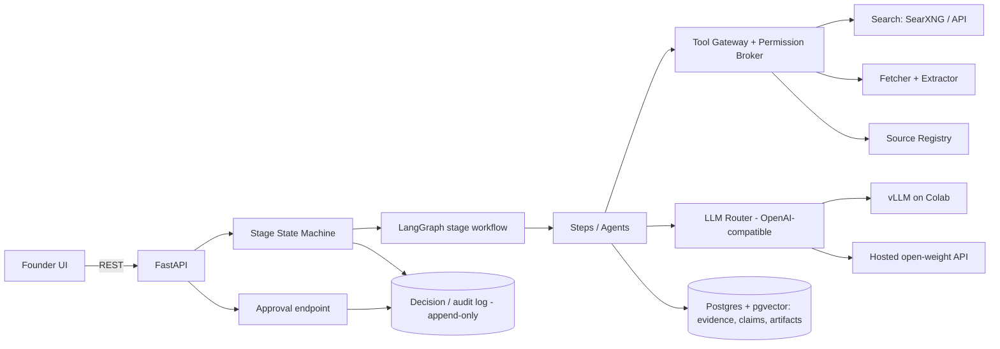
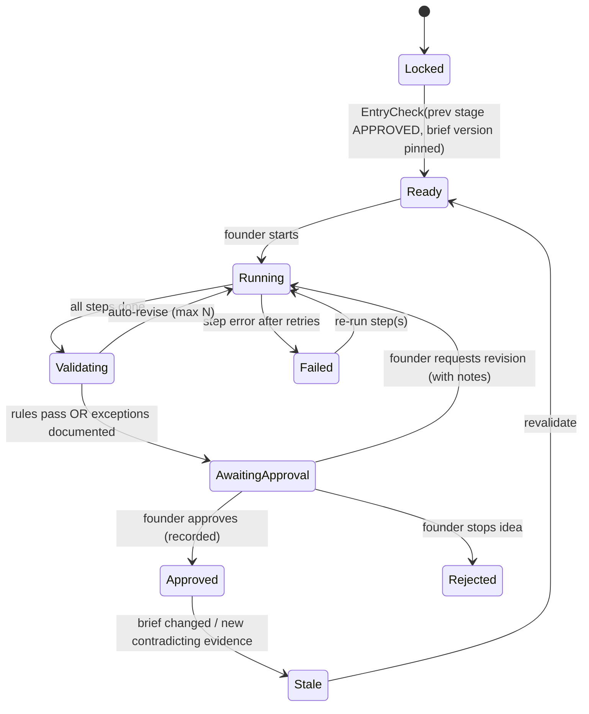
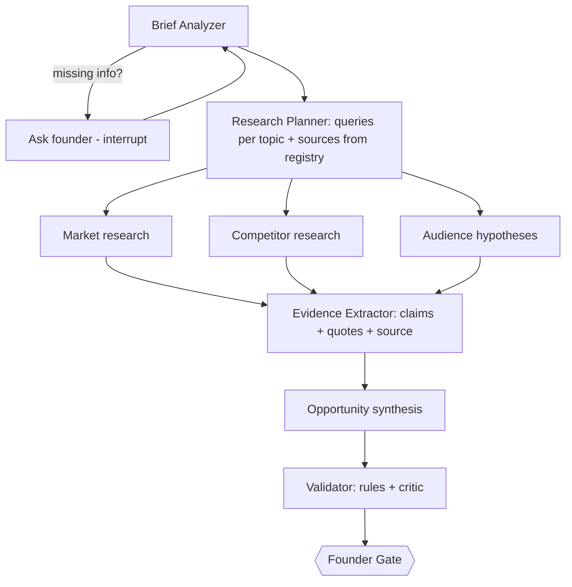

# Venture OS — Planning Report v0.1

> Status: **Background document, superseded in parts.** The organizers' `CLAUDE.md` (repo root, received
> 2026-11-16) sets the required layout and rules; decisions D13-D20 (§15b) record what changed. Current plan:
> [01-execution-plan.md](01-execution-plan.md); current status: [../HANDOFF.md](../HANDOFF.md).
> Original status: DRAFT for team review. Nothing is implemented. All model versions, prices and quotas below are
> **to be re-verified at decision time** — they change monthly. Items marked **[ASSUMPTION]** need confirmation.
> Date: 2026-11-16

---

## 0. Repository inspection — what exists today

| Check | Finding | Impact |
|---|---|---|
| Directory contents | `C:\Users\ASUS\Desktop\hackathon` is **empty** (only this planning folder, created now) | Greenfield; no conventions to preserve |
| `CLAUDE.md` | **Does not exist** (the brief says it does) | ⚠️ Conflict — either it lives in another clone/branch, or it hasn't been written yet. Please confirm before we bootstrap one. |
| Git | **Not a git repository**, no remote | CI-on-push requirement cannot be met until we `git init` + create a GitHub repo |
| Python | 3.13.0 (pip 26) | Several ML/agent libs lag on 3.13 → pin **3.12** via `uv` (not installed) |
| Node | 24.11 | Fine for a JS frontend if chosen |
| Docker | 29.9 | Fine — use Docker Compose for Postgres/pgvector + SearXNG locally |
| GPU | No NVIDIA GPU detected locally | All local inference must go to Colab or a hosted open-weight API |
| `gh` CLI | Not installed | Needed later for PR/Actions workflows (optional) |

**Missing everything** in the required list: README, CLAUDE.md, LICENSE, docs, env template, tests, CI, eval datasets.

---

## 1. Challenges to the brief (things I recommend changing)

1. **Six stages × ~8 agents ≈ 50 agents is the wrong unit of work for a hackathon.** Most "agents" in the brief are
   really *steps* (a prompt + a tool + a schema). Recommendation: implement each as a **typed step function**; only make
   something an autonomous *agent* (LLM loop choosing tools) where the path is genuinely unknown in advance — mainly
   *research* and *code generation*. Judges reward "acts, distinct, evidence-backed", not headcount.
2. **Do not fine-tune.** The goal is *traceable, dated, citable* evidence. Fine-tuning bakes facts into weights where they
   can't be cited, dated, or invalidated — the opposite of requirement 2B. Use RAG + a source registry. Fine-tuning is
   only worth revisiting later for a *small classifier* (e.g. source-credibility or claim-type tagging) once we have
   labelled data.
3. **"Every push → graded submission" must not call live LLMs or the web.** That's non-reproducible, costly, and leaks
   secrets. CI runs against a **deterministic replay layer** (recorded LLM/tool responses); a separate, manually or
   nightly triggered *live eval* uses secrets on `main` only.
4. **Stage 3 (Build) generating a "working MVP" is the riskiest promise.** For the demo, Build should produce a PRD + a
   **templated landing page / clickable prototype** from a fixed scaffold, not arbitrary full-stack code.
5. **A Validation Agent that is the same LLM grading itself is weak evidence.** Make validation mostly **deterministic
   rules** (every claim has ≥1 source, sources dated, no claim typed `fact` without a source, coverage of required
   sections) plus an optional LLM critic with a *different* model.
6. **Hierarchical "manager LLM delegates to worker LLMs"** is unreliable and hard to audit. Use a **deterministic state
   machine across stages** and **fixed DAGs inside stages** (details §3).

---

## 2. Deliverable 1 — Product & system specification

**Problem.** Early founders get generic, unsourced AI advice; they can't tell facts from guesses, and nothing enforces
disciplined validation before they spend time/money building.

**Solution.** An open-source, founder-controlled pipeline of specialised steps/agents that turns a brief into
evidence-backed deliverables, stage by stage, with explicit approval gates and a full decision log.

**Users.** Primary: first-time / solo founders with limited budget. Secondary: incubators & accelerators (multi-founder
view later). **[ASSUMPTION]** Demo persona targets the Egyptian / MENA market (CAPMAS mention) — confirm.

**In scope (MVP).** Onboarding brief → Discover → Gate → Validate (desk evidence + experiment plan) → Gate → decision log.
**Out of scope (MVP).** Real code generation, payments, publishing, outbound messaging, analytics integrations.

**Non-functional requirements.** Every claim traceable to source+retrieval date; reproducible CI runs; runs on free/
cheap infra; model-agnostic (OpenAI-compatible endpoint); bilingual-ready (Arabic/English) if MENA confirmed.

**Success metrics (MVP).**
- 100% of `fact`-typed claims in deliverables have ≥1 source with URL + retrieved_at.
- 0 external actions executed without a recorded scoped approval (tested).
- End-to-end Discover→Validate run on a demo brief in < 15 min on the chosen model endpoint **[target, unmeasured]**.
- Reject → revise → re-run → approve loop demonstrated live.

---

## 3. Deliverable 2 — Architecture

### 3.1 Orchestration choice

| Option | Verdict |
|---|---|
| Hierarchical multi-agent (LLM manager) | ❌ Non-deterministic routing, hard to audit, can "decide" to skip gates |
| Pure state machine | ✅ for **stage lifecycle** (gates must be un-bypassable code, not prompts) |
| DAG workflows | ✅ for **work inside a stage** (parallel research steps, then synthesis, then validation) |
| Event-driven | Later — useful for Stage 6 (metrics/webhooks); overkill now |
| **Hybrid (recommended)** | **Stage state machine in Postgres + LangGraph DAG per stage + HITL interrupts** |

Gates are enforced **outside the LLM**: the stage transition function checks the DB for an approval record; no tool,
prompt or agent can write that record (only the founder-authenticated API endpoint can).

### 3.2 High-level architecture



### 3.3 Stage lifecycle (every stage identical)



Returning to an earlier stage marks all later approved stages **Stale** (not deleted) — history kept.

### 3.4 Discover stage DAG (MVP)



### 3.5 Communication & context

- Steps never chat with each other. Each reads **typed inputs** (Pydantic) from the stage state and writes **typed outputs**
  + evidence IDs. Shared context = pinned **brief version** + evidence store + prior approved deliverables.
- Failure recovery: LangGraph checkpointer in Postgres → resume from last successful node; per-step retries with
  schema-repair; step marked `failed` with reason surfaced to founder rather than silently skipped.

### 3.6 Standard agent/step contract

```python
class StepSpec(BaseModel):
    id: str; role: str; stage: Stage
    input_schema: type[BaseModel]; output_schema: type[BaseModel]
    tools: list[str]                 # names in tool registry
    permission_tier: Tier            # max tier it may request (see §8)
    model_profile: str               # "reasoning" | "extract" | "code" | "judge"

class StepResult(BaseModel):
    step_id: str; run_id: UUID; status: Literal["ok","failed","needs_input"]
    output: dict; evidence_refs: list[UUID]
    claims: list[Claim]              # each typed fact | inference | assumption
    confidence: float | None; assumptions: list[Assumption]
    validation: Literal["pending","pass","fail","waived"]
    model: str; prompt_hash: str; started_at: datetime; finished_at: datetime
```

### 3.7 Data & evidence model (core tables)

`brief_versions` · `sources` (registry) · `documents` (url, fetched_at, hash, license, extracted text) ·
`chunks` (+ embedding) · `claims` (text, type, confidence, stage, run) · `claim_evidence` (claim↔chunk, quote span) ·
`assumptions` (status: open/confirmed/rejected by founder) · `artifacts` (deliverables, versioned) ·
`stage_runs` · `approvals` (scope, actor, timestamp, hash of what was approved) · `audit_log` (append-only).

### 3.8 Technology stack (recommended)

| Layer | Choice | Why / trade-off |
|---|---|---|
| Workflow | **LangGraph** | Explicit graphs, checkpointing, `interrupt()` for HITL; more verbose than CrewAI |
| API | FastAPI + Pydantic v2 | Typed schemas double as LLM structured-output schemas |
| DB | PostgreSQL 16 + **pgvector** | One DB for relational evidence + vectors; avoids a second store |
| LLM access | OpenAI-compatible client + small router | Swap Colab vLLM / Ollama / hosted provider with config only |
| Inference | vLLM (Colab) / Ollama (laptop CPU fallback, slow) | vLLM has better throughput + structured output |
| Search | SearXNG (self-host, free) + optional Brave/Tavily API | SearXNG quality varies; paid API more reliable |
| Extraction | trafilatura (HTML), pypdf/docling (PDF) | Open-source |
| Embeddings | multilingual small model (e.g. multilingual-e5 / bge-m3 class) | Arabic+English if MENA |
| UI | **Decision needed** (§12) — Streamlit vs Next.js | |
| Observability | Langfuse (self-hostable, OSS) or OpenTelemetry → console | Traces double as demo evidence |
| Packaging | uv, Docker Compose, Makefile | One-command setup |
| CI | GitHub Actions + GitHub Pages dashboard | §10 |

---

## 4. Deliverable 3 — Agent / step specification matrix

Legend: **A** = autonomous agent (LLM tool loop), **S** = single LLM step, **D** = deterministic code. MVP column ✅ = built,
◐ = simplified, — = later.

| Stage | Agent/step | Kind | MVP | Responsibility | Inputs → Outputs | Tools | Validation |
|---|---|---|---|---|---|---|---|
| 0 | Brief Analyzer | S | ✅ | Structure brief, list gaps, ask questions | raw brief → `Brief` + `Question[]` | — | required fields filled or explicitly "unknown" |
| 0 | Stage Entry Checker | D | ✅ | Verify prev approval + brief pin | stage id → ok/deny | DB | unit-tested |
| 1 | Research Planner | S | ✅ | Pick sources from registry, generate queries | Brief → `ResearchPlan` | registry | ≥1 query per topic; sources match geo/industry |
| 1 | Market Research | A | ✅ | Search, fetch, extract market facts | plan → `Claim[]` | search, fetch | each claim has source+date |
| 1 | Competitor Intelligence | A | ✅ | Direct/indirect competitors | plan → `Competitor[]` | search, fetch | URL per competitor; dedupe |
| 1 | Audience Hypotheses | S | ✅ | Segments as *hypotheses* | claims → `Hypothesis[]` | retrieval | labelled hypothesis, linked evidence |
| 1 | Industry Intelligence | A | ◐ merged into Market | Trends | — | — | — |
| 1 | Idea Research | — | merged into Planner | — | — | — | — |
| 1 | Opportunity Analysis | S | ✅ | Gaps/problems | all → `Opportunity[]` | retrieval | each cites ≥2 evidence items or marked assumption |
| 1 | Research Validator | D+S | ✅ | Source checks, freshness, contradictions | claims → report | registry | rules (§8) |
| 2 | Sentiment / Review mining | A | ✅ | Public reviews/forums (where ToS allows) | competitors → `Quote[]`, themes | search, fetch | verbatim quote + URL; no synthesis presented as quote |
| 2 | Competitor Benchmarking | S | ✅ | Feature/price matrix | competitors → table | fetch | cell-level source |
| 2 | Demand Analysis | S | ◐ | Demand indicators, market sizing w/ method shown | claims → estimate+range | retrieval, calculator | formula + inputs shown; labelled estimate |
| 2 | Value Proposition | S | ✅ | VP canvas | all → `ValueProp` | — | maps to evidenced pains |
| 2 | Business Model | S | ◐ | Lean canvas | — | — | assumptions flagged |
| 2 | Experiment Designer | S | ✅ | Smoke-test/interview/survey plans w/ success thresholds | → `Experiment[]` | — | each has metric+threshold+cost |
| 2 | Customer Discovery | S | ◐ | Interview script + **founder-entered** results ingestion | → script; founder data → evidence | — | results only from founder input, typed `primary_founder_reported` |
| 2 | Validation Evidence Checker + Go/Revise/Stop | D+S | ✅ | Evidence ladder scoring (interest < stated WTP < demonstrated WTP < purchase) | → recommendation | — | recommendation cites ladder level |
| 3 | PRD + user stories + MVP prioritization | S | ◐ | | | | — |
| 3 | Landing-page generator (template) | S | ◐ | | | | — |
| 3 | Architect / BE / FE / DB / QA / Security | A | — | Code agents | | sandbox | later |
| 4 | Pricing, cost, revenue, legal research | S/A | — | | | | jurisdiction-labelled, "not legal advice" |
| 5 | GTM, brand, content, SEO, launch planner | S | — | All publish actions Tier 4 | | | |
| 6 | Analytics, feedback, experiments, roadmap | A | — | Needs real integrations | | | real vs projected labels |

---

## 5. Deliverable 4 — MVP definition

**Build first: Onboarding + Stage 1 Discover + Stage 2 Validate (desk research + experiment plan) + both gates.**
Rationale: these are where "evidence-based" and "founder-controlled" are provable; Build/Launch without validated
evidence would undercut our own thesis. Stage 3 appears as a **thin, labelled stub** (PRD + templated landing page) so
the end-to-end arc is visible.

**Demo flow (smallest end-to-end):**
1. Founder submits incomplete brief → system asks 3–5 targeted questions.
2. Discover runs live: queries, fetched sources, extracted claims visible in a trace.
3. Validator flags e.g. a stale (>3y) statistic and an unsourced claim → auto-revision.
4. Founder **rejects** one section with a note → re-run of only that step → approves.
5. Validate runs: review quotes, competitor matrix, evidence ladder, experiment plan, **Go / Revise / Stop**.
6. Founder changes brief (new target city) → later stages flip to **Stale**.
7. Show decision log + a blocked "publish landing page" action that requires a scoped approval.

| Fully functional | Simplified | Mocked (labelled "DEMO DATA" in UI) | Excluded |
|---|---|---|---|
| Brief, state machine, gates, approvals, audit log, search+fetch+extract, evidence store, claim typing, validator rules, CI | Industry agent merged; market sizing as range with shown formula; Stage 3 template-only | Survey/interview *results* (clearly fake-labelled demo founder input) only if no real data; any paid-data sources | Code-gen agents, payments, publishing, email, analytics, multi-user auth |

**Acceptance criteria.** (a) A run produces deliverables where every `fact` claim resolves to a stored document with
URL + `retrieved_at`; (b) stage N+1 API returns 403 without approval of N (test); (c) a rejected stage can be revised and
re-approved with both events in the log; (d) a Tier-4 tool call without a matching scoped approval is blocked (test);
(e) `make demo` reproduces the run from replay fixtures offline.

---

## 6. Deliverable 5 — Roadmap (milestones)

Complexity: S ≈ ½ day, M ≈ 1–2 days, L ≈ 3+ days (for 1 dev; **[ASSUMPTION]** team size/time unknown).

| # | Milestone | Key tasks | Expected files | Acceptance / tests | Cx |
|---|---|---|---|---|---|
| M0 | Repo bootstrap | git init, README, CLAUDE.md, LICENSE, uv, Compose (Postgres+pgvector), Makefile, `.env.example`, CI skeleton | `pyproject.toml`, `docker-compose.yml`, `Makefile`, `.github/workflows/ci.yml` | `make setup && make test` green on CI | S |
| M1 | Domain core | Pydantic models (Brief, Claim, Evidence, Assumption, Approval), DB schema + migrations (Alembic), audit log | `core/models.py`, `db/migrations/` | unit tests for models, append-only log | M |
| M2 | State machine + gates | Stage lifecycle, entry checker, approval endpoint, Stale propagation | `core/stages.py`, `api/routes/approvals.py` | gate-bypass tests, revision loop tests | M |
| M3 | LLM router + replay layer | OpenAI-compatible client, model profiles, record/replay cassettes, structured output w/ repair | `llm/router.py`, `llm/replay.py` | deterministic replays in CI | M |
| M4 | Tool gateway + permissions | Tool registry, tiers, scoped approvals, injection sanitiser for fetched content | `tools/`, `security/permissions.py` | tier-escalation tests | M |
| M5 | Evidence pipeline | Source registry YAML, search, fetch, extract, chunk, embed, dedupe (hash + near-dup), freshness | `evidence/`, `config/sources/*.yaml` | grounding tests on fixtures | L |
| M6 | Stage 1 workflow | LangGraph DAG, brief Q&A interrupt, research steps, validator | `stages/discover/` | golden-run eval on 3 briefs | L |
| M7 | UI | Brief form, run view w/ trace, evidence panel, approve/reject/revise | `ui/` | manual + smoke | M |
| M8 | Stage 2 workflow | reviews, benchmark, evidence ladder, experiment plan, Go/Revise/Stop | `stages/validate/` | eval set | L |
| M9 | Eval & dashboard | graders, scoring, Pages dashboard | `evals/`, `.github/workflows/eval.yml` | dashboard shows SHA+scores | M |
| M10 | Demo hardening | Colab notebook, recorded demo fallback, pitch | `notebooks/`, `docs/demo.md` | dry-run x2 | M |
| Later | Stage 3 stub → real; Stages 4–6 | | | | |

Critical path: M0→M1→M2→M3→M5→M6. M4/M7/M9 can run in parallel with M5/M6 by different team members.

---

## 7. Deliverable 6 — Technology & model comparison

### 7.1 Agent frameworks

| | LangGraph | CrewAI | AutoGen / AG2 | Plain Python + Pydantic |
|---|---|---|---|---|
| Control flow | Explicit graph ✅ | Role/crew abstraction, implicit | Conversational agents | Total control |
| HITL interrupts | Built-in | Limited | Possible | Hand-roll |
| Checkpoint/resume | Built-in (Postgres saver) | Limited | Limited | Hand-roll |
| Auditability | High | Medium | Low (chatty) | High |
| Learning curve | Medium-high | Low | Medium | Low |
| **Verdict** | **Use** | Too implicit for gates | Conflicts with "don't just converse" | Fallback if LangGraph slows us down |

(Also viable: PydanticAI for typed single-agent loops inside LangGraph nodes — optional.)

### 7.2 Models (open-weight) — **verify current releases/licences before locking**

Principle: **profiles, not one model.** Configure per profile; any OpenAI-compatible endpoint.

| Profile | Need | Candidate families | Notes |
|---|---|---|---|
| `extract` / classify | fast, JSON, cheap | Qwen small/mid (≈7–8B), Llama small, Mistral small | Fits Colab T4 at 4-bit |
| `reasoning` / synthesis | long context, tool calling | Qwen larger instruct / MoE, DeepSeek V-series, Mistral medium/large-class | Usually too big for free Colab → hosted open-weight API |
| `code` (later) | coding | Qwen-Coder family, DeepSeek coder-class | Hosted |
| `judge` | different family from generator | e.g. Llama or Mistral if generator is Qwen | Reduces self-grading bias |
| `embed` | multilingual | bge-m3 / multilingual-e5 class | Runs on CPU |

Licensing: Qwen (most sizes) and Mistral (many) are Apache-2.0; DeepSeek uses MIT/own licences per release; **Llama has
a community licence with use restrictions (not OSI-open)** — relevant to the "Openness" criterion. I'm deliberately not
quoting benchmark numbers; we should run our own small eval (M9) on 20–30 extraction/grounding cases per candidate.

### 7.3 Vector store

| pgvector | Qdrant | Chroma |
|---|---|---|
| Same DB as evidence/audit → transactional joins claim↔chunk ✅ | Better at large scale, extra service | Easy, weaker for prod |
**Use pgvector**; revisit at >~1M chunks.

### 7.4 Knowledge graph
Not for MVP. The `claim_evidence` relational table already gives traceability. Reconsider for entity resolution across
competitors/markets later.

### 7.5 RAG vs fine-tuning (requirement 6 IMPORTANT)

| | RAG | Fine-tune | Base model only | Hybrid |
|---|---|---|---|---|
| Citable & dated | ✅ | ❌ | ❌ | ✅ via RAG part |
| Update cost | re-index | retrain | — | |
| Hallucination control | grounded prompts + checks | none per-fact | none | |
| **Use** | **Yes** | Only later, for style/classifiers | No | Later |

---

## 8. Deliverable 8 — Trust & safety specification

**Claim typing.** Every claim is `fact` (needs ≥1 evidence span), `inference` (needs ≥1 premise claim), or `assumption`
(needs rationale; if `material=true` → founder must confirm before gate).

**Evidence rules (deterministic validator).**
- Source must be in registry *or* auto-classified with credibility tier (official stats > intergovernmental > peer-reviewed
  > industry report > company site > news > forum/UGC).
- `retrieved_at` required; `published_at` extracted when possible; freshness threshold per claim type (e.g. market stats
  > 3 years → warning) — configurable.
- Geographic relevance: source geo must match brief geo or claim marked "proxy market".
- Dedupe: content hash + near-duplicate check; syndicated copies count as one source.
- Contradiction detection: same metric, different values → surfaced to founder, not averaged silently.
- Customer feedback quotes must be verbatim spans from fetched documents; generated paraphrase can never be typed as quote.

**Permission tiers.**

| Tier | Examples | Rule |
|---|---|---|
| T0 Read-only | search, fetch public page, read DB | allowed; rate-limited; robots/ToS respected |
| T1 Internal analysis | LLM generation, document drafts | allowed |
| T2 Reversible internal | write artifacts, re-run steps | allowed, logged |
| T3 External (approval) | publish page, send email/survey, spend, post | **blocked unless `approval(scope=exact action+payload hash, expiry)` exists**; stage approval ≠ action approval |
| T4 Prohibited | sign contracts, move/hold money, store passwords/cards, impersonate, guarantee outcomes | not implemented as tools at all; output filter blocks income guarantees |

**Prompt-injection defences.** Fetched content is wrapped as data and never in system role; research agents have
**no T3 tools in their toolset** (capability-based, so injection can't escalate); output schemas reject unexpected tool
requests; URLs from fetched pages are not auto-followed beyond depth 1 without planner approval.

**Audit.** Append-only `audit_log` (hash-chained rows) recording run, step, model, prompt hash, tools called, approvals,
brief version. Founder can export it.

**Failure handling.** Retry with backoff → schema repair → mark step `failed` with reason → founder may re-run, edit
input, or waive (waiver recorded as exception).

---

## 9. Deliverable 7 — Proposed repository structure

```
venture-os/
├── README.md  CLAUDE.md  LICENSE  Makefile  pyproject.toml  docker-compose.yml  .env.example
├── docs/        architecture.md  agents/  safety.md  costs.md  demo.md  adr/0001-*.md  planning/
├── src/venture_os/
│   ├── core/        models.py  stages.py  brief.py  audit.py
│   ├── api/         main.py  routes/
│   ├── llm/         router.py  replay.py  profiles.yaml
│   ├── tools/       registry.py  search.py  fetch.py  extract.py
│   ├── security/    permissions.py  sanitize.py
│   ├── evidence/    store.py  ingest.py  validate.py  credibility.py
│   └── stages/      discover/  validate/  build/ (stub)  _template/
├── config/sources/  global.yaml  egypt.yaml  ...
├── ui/
├── evals/           datasets/  graders/  run_eval.py
├── tests/           unit/  integration/  smoke/  safety/  fixtures/cassettes/
├── notebooks/       colab_inference.ipynb
└── .github/workflows/  ci.yml  eval-live.yml  pages.yml
```

`stages/_template/` makes adding Stage 4–6 a copy-and-fill exercise (extensibility proof for judges).

**Source registry entry (example schema):**
```yaml
- id: worldbank_wdi
  name: World Bank – World Development Indicators
  type: intergovernmental_statistics
  geo: global
  industries: [macro]
  freshness: annual
  access: api            # api | scrape | manual_upload | search_only
  credibility_tier: 2
  limitations: "Country-level; lags 1–2 years"
  license: "verify – CC BY 4.0 for most datasets"
```
CAPMAS, ITC, OECD, UN Data etc. get entries **only after we verify access method & terms** (several are portal-only, no
stable API; Google Scholar has **no official API and prohibits scraping** → use Semantic Scholar / OpenAlex instead).

---

## 10. Deliverable 10 — Evaluation framework & CI

**Pipelines.**
- `ci.yml` on every `push` and `pull_request` (**no secrets**, read-only token): lint/type check → config/registry
  schema validation → unit → integration (Postgres service container) → smoke (`make demo` on replay cassettes) →
  agent-workflow tests → grounding tests → safety tests → `evals/run_eval.py` → `results.json` artifact.
- `pages.yml` on `push` to `main` only: append results to a JSON history on `gh-pages` and render a static dashboard
  (SHA, timestamp, status, overall + category scores, failed tests, safety violations).
- `eval-live.yml`: `workflow_dispatch` / nightly on `main` only, uses secrets (hosted model key), records new cassettes.
- Never use `pull_request_target` with checkout of PR code. Forks get no secrets. Pin actions by SHA.

**Category scoring (mapped to judging criteria).**

| Criterion | Automated metric |
|---|---|
| Claims & evidence | % fact-claims with resolvable evidence; % with retrieved_at; quote-span exact-match rate; stale-source rate |
| Prototype functionality | golden workflow pass rate; deliverable schema completeness |
| Control & safety | gate-bypass tests (must be 0 failures); T3-without-approval attempts blocked; injection fixtures blocked; banned-phrase (income guarantee) check |
| Architecture | stage template conformance; test coverage ≥ threshold |
| Openness | licence check of deps (no copyleft conflicts), model licence recorded, docs present |
| Sustainability | tokens & est. cost per run recorded from replay metadata |
| Pitch | manual |

Safety violations are a **hard fail** regardless of total score.

---

## 11. Deliverable — Google Colab environment

| Runs where | What |
|---|---|
| **Colab (GPU)** | vLLM OpenAI-compatible server for `extract` profile (≈7–8B, 4-bit AWQ/GPTQ) |
| **Local laptop** | FastAPI, LangGraph, UI, Postgres+pgvector (Docker), SearXNG, embeddings (CPU) |
| **External** | Hosted open-weight API for `reasoning` (e.g. a provider serving Qwen/DeepSeek/Mistral), GitHub, optionally managed Postgres (Neon/Supabase free tier) for teammates |

Realities: free-tier Colab GPU is typically a **T4 with ~15–16 GB** and is **not guaranteed**; sessions disconnect
(idle / max runtime); disk is ephemeral → **no state in Colab**, model weights cached on Google Drive. T4 lacks bf16 →
fp16/AWQ. Expose via **Cloudflare Tunnel** (quick tunnel) or ngrok **with an API key** on vLLM (`--api-key`); rotate per
session; never commit URLs. Always keep the hosted endpoint as fallback so the demo doesn't depend on Colab.

---

## 12. Deliverable 9 — Cost estimate (all rough, **[ESTIMATE]**, verify prices)

| Environment | Main costs | Order of magnitude |
|---|---|---|
| Local dev | Docker on laptop, SearXNG | $0 |
| Colab prototype | Free tier, or Colab Pro (~$10/mo class) for more reliable GPU | $0–15/mo |
| Hosted open-weight inference for reasoning | per-token pricing; a Discover+Validate run perhaps 0.3–1M tokens **[unmeasured]** | likely cents to ~$1 per run; measure in M9 |
| Small deployment | small VPS + managed Postgres + search API | ~$20–60/mo |
| Production | GPU inference (dedicated) or API, Postgres HA, observability | $hundreds+/mo, dominated by inference; size after usage data |

We will replace these with **measured** token counts per run from M9.

---

## 13. Deliverable 11 — Pitch strategy (outline)

1. **Hook (30s):** "AI gives founders confident answers. We give them *evidence* and a *veto*."
2. **Live demo (3 min):** the 7-step flow in §5 — emphasise the reject/revise loop and the blocked publish action.
3. **Click any claim → see the source, quote and date.** Show an assumption being confirmed by the founder.
4. **Architecture slide:** state machine + DAG + tool gateway; "gates are code, not prompts."
5. **CI dashboard:** every commit graded, safety violations = hard fail.
6. **Openness/sustainability:** Apache-2.0 repo, open-weight models, cost per run, how to add a new stage/market.
7. **Honesty slide:** what's mocked, what's next.

Have a **recorded replay** of the demo ready in case Wi-Fi/Colab fails (replay layer makes this free).

---

## 14. Risks

| Risk | Likelihood | Mitigation |
|---|---|---|
| Colab GPU unavailable at demo | High | hosted fallback + replay |
| Small models fail structured output / tool calling | Medium-high | schema repair, constrained decoding (vLLM guided JSON), bigger hosted model for reasoning |
| Search/scrape quality for MENA/Arabic sources | Medium | registry-driven targeted queries, manual PDF upload of reports |
| Source ToS / licensing | Medium | `access` + `license` fields; prefer APIs; no Google Scholar scraping |
| Scope creep into Stages 3–6 | High | MVP gates fixed in this doc |
| Empty repo / missing CLAUDE.md | Certain | confirm location before M0 |

---

## 15a. Decisions log (2026-11-16)

| # | Decision | Consequence |
|---|---|---|
| D1 | CLAUDE.md provided later | M0 bootstraps without it; re-check conventions when it arrives |
| D2 | Hosted open-weight API primary, Colab secondary | see item 2 below |
| D3 | UI = **Streamlit** | `ui/` is a Streamlit app calling FastAPI |
| D4 | Demo market = **Egypt**, bilingual **English + Arabic** | multilingual embeddings (bge-m3 class); Arabic queries in planner; RTL text in UI |
| D5 | Team = **3 people, 30 hours** (~90 person-hours) | scope cut below |
| D6 | Search = **free only**: SearXNG + CAPMAS + ITC | CAPMAS/ITC are *sources*, not search engines → registry entries with `access: manual_upload` or portal download, verify terms; ITC tools may require free registration **[verify]** |
| D7 | Licence = **Apache-2.0** | permissive + patent grant; check dependency licences in CI |
| D8 | Crawler-found sources: option (a) | official bodies auto-added as provisional tier B (30-day expiry); everything else to admin queue |
| D9 | **Zero spend** (2026-11-16) | no payment method on any account; only free tiers, free model variants, Colab free GPU and local models; recorded replays for CI and demo backup. Supersedes the cost estimates in section 12 |
| D10 | Founder onboarding = chat bot | chat with document upload; asks for missing brief fields before any stage starts |
| D11 | Onboarding model = **Fanar-C-2-27B** via the Fanar API | Arabic incl. Egyptian dialect, Apache 2.0; tested 2026-11-16; 50 req/min; free status to confirm |
| D12 | Scope = **all six stages** | Discover + Validate deep, Build/Commercial/Launch/Operate thin from one template; see 01-execution-plan.md |

## 15b. Decisions after the organizers' rules arrived (2026-11-16/17)

| # | Decision | Consequence |
|---|---|---|
| D13 | Follow the organizers' `CLAUDE.md` exactly; it lives at the repo root (replaces D1) | README with 8 fixed headings, `ARCHITECTURE.md`, `decision_log.json`, `outputs/phase<N>_step<M>_*`, `prompts/`, role-named code files |
| D14 | Deadline is `main` at Tue 2026-11-17 23:59; feature freeze 18:00 | Scope cut to: onboarding + Phase 1 working, Phase 2 thin, Phases 3-6 STUBBED and labelled (replaces D12's depth) |
| D15 | Team of 3: A onboarding + safety, B pipeline (phases 1-2, gates), C setup + architecture + phases 3-6 | File ownership in 02-parallel-work.md |
| D16 | Default model: a local open-weight model via Ollama in Docker; Fanar optional (replaces D2/D11 as the default) | `docker compose up` works with no key; onboarding also runs with no model |
| D17 | No payments of any kind, not even sandbox; delivery MOCKED | Sale to cash shown in ARCHITECTURE.md only, with idempotency and refunds designed but mocked |
| D18 | Guardrails in plain code: excluded products and must-never requests (EN + AR), `check_output()` on generated text | Excluded briefs cannot be confirmed; refusals logged |
| D19 | Onboarding confirmation is the first gate (`approved_by: "founder"`), versioned brief is the hand-off | Pipeline reads `load_brief()`; a newer brief version makes later stage runs stale |
| D20 | Trick prompts and injection tests for our own guardrails only under `tests/` (organizers confirmed 2026-11-17; injection aimed at their grading disqualifies, so nothing addresses graders); `outputs/` and `decision_log.json` only from a real run | Moved `docs/demo/` to `tests/fixtures/personas/`; tests write to a temp folder |

**30-hour scope cut** *(superseded by D12 and [01-execution-plan.md](01-execution-plan.md); kept for history)*. Build: brief + questions, Discover DAG, validator rules, 2 gates, approvals/audit log,
Stage 2 *lite* (competitor matrix, review quotes, evidence ladder, Go/Revise/Stop), Streamlit UI, CI with replay
tests + simple JSON results page. Defer: Langfuse, Pages history dashboard polish, Stage 3 stub, Stale propagation UI
(keep in DB only), Alembic (use a single SQL schema file).
Suggested split: **P1** core/DB/state machine/gates/CI · **P2** evidence pipeline (SearXNG, fetch, extract, registry,
pgvector) + LLM router · **P3** Streamlit UI + prompts/stage steps + demo script & pitch. Hour ~20: freeze features.

## 15. Decisions needed from the team (before M0)

> All items below are resolved (D1–D12). Kept for history.

1. **CLAUDE.md** — where is it? If it doesn't exist, may I draft one in M0?
2. ~~**Inference strategy**~~ — ✅ **DECIDED 2026-11-16: (b) hosted open-weight API primary**; Colab vLLM kept as the
   "fully self-hosted" proof and secondary endpoint. Rationale: demo reliability; Colab GPU availability is not
   guaranteed. Consequence: LLM router defaults to hosted endpoint; provider choice + key handling needed in M3.
3. **UI** — Streamlit (fastest, Python-only, less polished) vs Next.js/React (polished, slower to build, needs a JS dev).
   Recommend **Streamlit** unless a teammate is strong in React.
4. **Demo market & language** — Egypt/MENA with Arabic sources? Specific demo idea?
5. **Licence** — Apache-2.0 (recommended: patent grant, permissive) vs MIT vs AGPL.
6. **Team & timeline** — how many devs, how many days until judging? Affects whether Stage 2 is full or partial.
7. **Search provider** — SearXNG only (free) vs a paid search API key for reliability.
